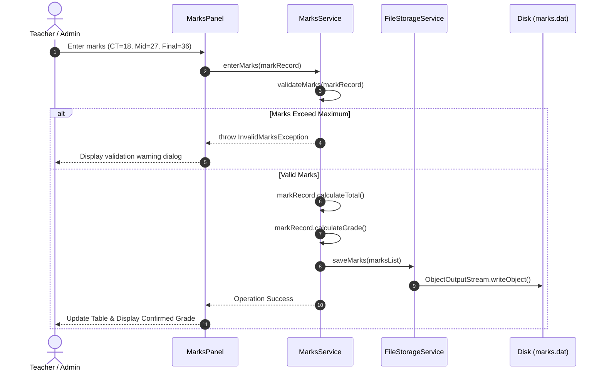
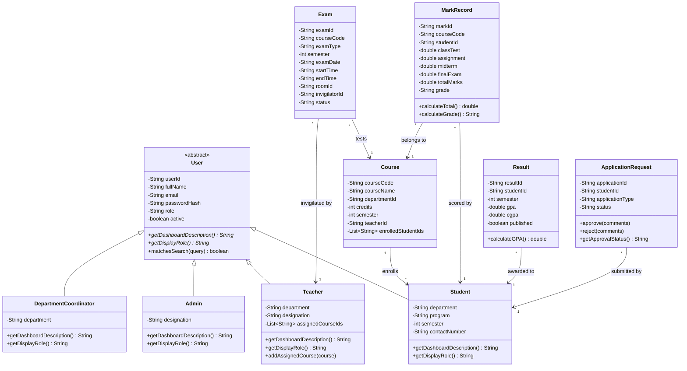

# Application Architecture — EduAsset

## University Examination & Academic Assessment Management System

---

## 1. Architectural Overview

EduAsset is engineered as a three-tier, object-oriented desktop application developed with standard Java and Java Swing. The architecture strictly decouples graphical presentation, business domain logic, and physical data persistence through clean interfaces and design patterns.

```
┌─────────────────────────────────────────────────────────────────┐
│                     PRESENTATION TIER (UI)                      │
│   MainFrame, SidebarPanel, TopBarPanel, LoginFrame              │
│   14 Modular Panels (Student, Exam, Marks, Results, etc.)       │
│   Reusable Components (RoundedPanel, StatCard, DataTablePanel)  │
└───────────────────────────────┬─────────────────────────────────┘
                                │ Method Invocation / Callbacks
                                ▼
┌─────────────────────────────────────────────────────────────────┐
│                      SERVICE TIER (LOGIC)                       │
│   Singleton Services (AuthService, StudentService, ExamService) │
│   Conflict Engine, Grade Calculator, Boundary Validator         │
│   Authorization & Session Enforcement                           │
└───────────────────────────────┬─────────────────────────────────┘
                                │ Domain State & Persistence
                                ▼
┌─────────────────────────────────────────────────────────────────┐
│                   MODEL & PERSISTENCE TIER                      │
│   14 Serializable Entities (User, Student, Course, Exam, etc.)  │
│   FileStorageService (ObjectOutputStream / ObjectInputStream)   │
│   Binary Data Storage (./data/*.dat)                            │
└─────────────────────────────────────────────────────────────────┘
```

---

## 2. Package Responsibilities & Modular Structure

| Package Name | Responsibilities | Key Classes |
|---|---|---|
| `com.examsphere` | Application entry point and lifecycle initialization. | `Main.java` |
| `com.examsphere.model` | Serializable domain entity classes encapsulating business state. | `User`, `Student`, `Teacher`, `Admin`, `Course`, `Exam`, `ExamRoom`, `MarkRecord`, `Result`, `ApplicationRequest` |
| `com.examsphere.interfaces`| Behavioral contracts governing searchable, approvable, and reporting capabilities. | `Searchable`, `Approvable`, `ReportGenerator` |
| `com.examsphere.service` | Singleton business logic services, validation, and workflow engines. | `AuthService`, `StudentService`, `CourseService`, `ExamService`, `MarksService`, `ResultService` |
| `com.examsphere.storage` | Java Object Serialization persistence engine with backup handling. | `FileStorageService` |
| `com.examsphere.exception`| Custom application exceptions for domain validation and business errors. | `ScheduleConflictException`, `InvalidMarksException`, `DuplicateStudentIdException`, `AuthorizationException` |
| `com.examsphere.components`| Reusable custom Swing components featuring Graphics2D anti-aliasing. | `RoundedPanel`, `StatCard`, `DataTablePanel`, `CustomButton`, `FormDialog` |
| `com.examsphere.ui` | Main window container, collapsible sidebar, top navigation, and module panels. | `MainFrame`, `LoginFrame`, `SidebarPanel`, `TopBarPanel`, `DashboardPanel`, `StudentPanel`, etc. |
| `com.examsphere.util` | System utilities, theme palette manager, password hasher, and ID generator. | `ThemeManager`, `Constants`, `ValidationUtil`, `PasswordUtil`, `GradeCalculator` |

---

## 3. Application Navigation & Screen Management

Rather than repeatedly creating, displaying, and disposing independent OS-level windows (`JFrame`), EduAsset utilizes a single master window (`MainFrame`) structured with a standard Swing `BorderLayout`:

```
┌────────────────────────────────────────────────────────────────────────┐
│ TopBarPanel (BorderLayout.NORTH - 62px)                                │
├──────────────┬─────────────────────────────────────────────────────────┤
│ SidebarPanel │ Content Container (BorderLayout.CENTER)                 │
│              │ CardLayout ("contentCards")                             │
│ (BorderLayout│                                                         │
│  .WEST)      │   ├─ "overview"       → DashboardPanel                  │
│              │   ├─ "students"       → StudentPanel                    │
│ 256px / 84px │   ├─ "departments"    → CoursePanel                     │
│              │   ├─ "examScheduling" → ExamPanel                       │
│              │   ├─ "rooms"          → RoomPanel                       │
│              │   ├─ "attendance"     → AttendancePanel                 │
│              │   ├─ "invigilators"   → InvigilatorPanel                │
│              │   ├─ "marks"          → MarksPanel                      │
│              │   ├─ "results"        → ResultsPanel                    │
│              │   ├─ "applications"   → ApplicationsPanel               │
│              │   ├─ "reports"        → ReportsPanel                    │
│              │   ├─ "history"        → HistoryPanel                    │
│              │   ├─ "users"          → UserManagementPanel             │
│              │   └─ "settings"       → SettingsPanel                   │
└──────────────┴─────────────────────────────────────────────────────────┘
```

### CardLayout Switching Sequence
1. User clicks an active navigation item in `SidebarPanel`.
2. `SidebarPanel` invokes `mainFrame.showPanel(targetCardName)`.
3. `MainFrame` triggers `cardLayout.show(contentPanel, targetCardName)`.
4. `TopBarPanel` updates its title label to reflect the active view.
5. `SidebarPanel` highlights the active item with the primary accent background color.

---

## 4. Communication & Data Flow



---

## 5. Object-Oriented Domain Class Relationships



---

## 6. Error-Handling Architecture

EduAsset uses a structured exception hierarchy rooted in `java.lang.Exception`. Business logic errors originate in the service layer, bubble to the presentation layer, and present user-friendly modal alerts via `JOptionPane`:

```
java.lang.Throwable
  └── java.lang.Exception
        ├── DuplicateStudentIdException  (Duplicate ID on account creation)
        ├── InvalidMarksException        (Component score > maximum or < 0)
        ├── ScheduleConflictException    (Room/invigilator overlap, time order)
        ├── InvalidLoginException        (Bad credentials or deactivated user)
        ├── InvalidApplicationException  (Blank mandatory grievance fields)
        ├── AuthorizationException       (Permission check failure)
        └── DataStorageException         (File I/O failure during serialization)
```

### Exception Propagation Flow
1. **Trigger:** `ExamService.createExam(Exam)` detects that `checkRoomConflict()` returned `true`.
2. **Throw:** Service executes `throw new ScheduleConflictException("Room KT-320 is already booked...");`.
3. **Catch in UI:** `ExamPanel` catches `ScheduleConflictException`.
4. **Display:** Dialog displays `"Conflict Detected: Room KT-320 is already booked on 2026-12-10 during 10:00 - 12:00."` as a `WARNING_MESSAGE`.
5. **Recovery:** Form dialog remains open so the user can select an alternative room without retyping form fields.

---

## 7. Java Object Serialization Persistence Flow

EduAsset does not require an external SQL database server. Persistence is achieved through native Java Object Streams:

1. **Storage Directory:** Upon application startup, `FileStorageService` verifies or generates the `./data/` directory.
2. **In-Memory Cache:** Each service initializes an in-memory `List<T>` loaded at startup from disk via `storage.loadList(filename)`.
3. **Serialization Mutation:** When a mutating action occurs (e.g. `addStudent`, `createExam`, `enterMarks`), the service updates its in-memory list and writes the updated list through `storage.saveList(list, filename)`.
4. **Resilience:** If a `.dat` file is absent or corrupted, `loadList()` catches the `IOException` / `ClassNotFoundException`, issues a console warning, and returns an empty list, allowing the application to self-seed without crashing.

---

## 8. Threading & Concurrency Architecture

### Event Dispatch Thread (EDT)
All Swing GUI construction, component painting, and user event handling reside strictly on the Swing EDT. `Main.java` starts the application using:
```java
SwingUtilities.invokeLater(() -> new LoginFrame());
```

### Background Worker Threads (`SwingWorker`)
Long-running operations—such as multi-department statistical aggregation and file export in `ReportsPanel`—use `javax.swing.SwingWorker`:
- `doInBackground()`: Compiles the institutional summary report and performs disk I/O on a background worker thread.
- `done()`: Executes back on the EDT to display completion dialogs and update UI indicators without UI freezing.

