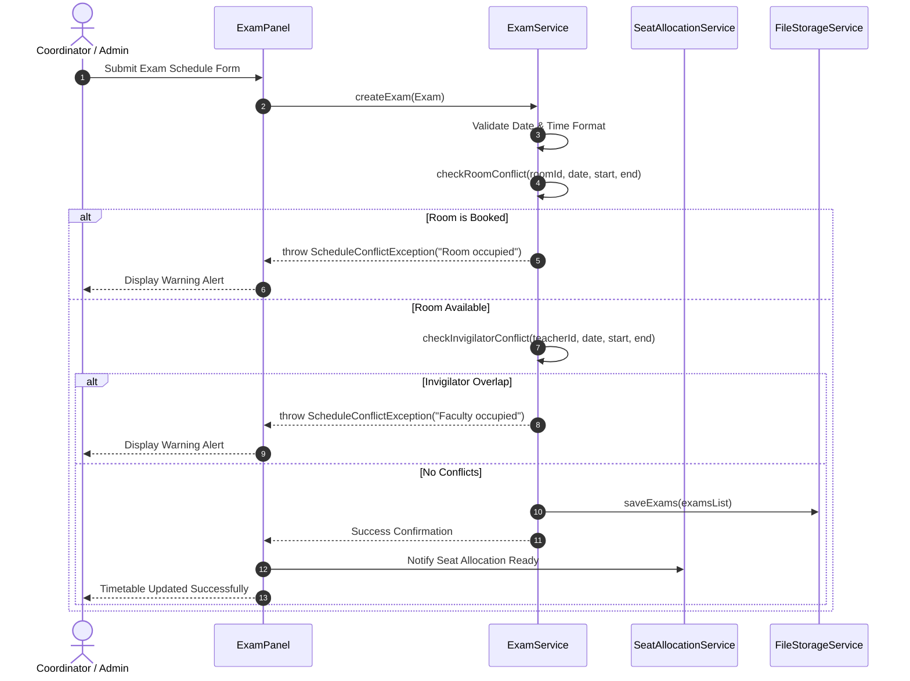
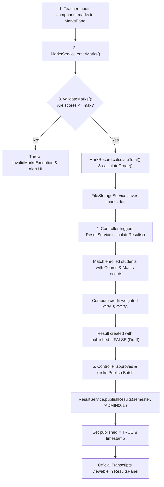
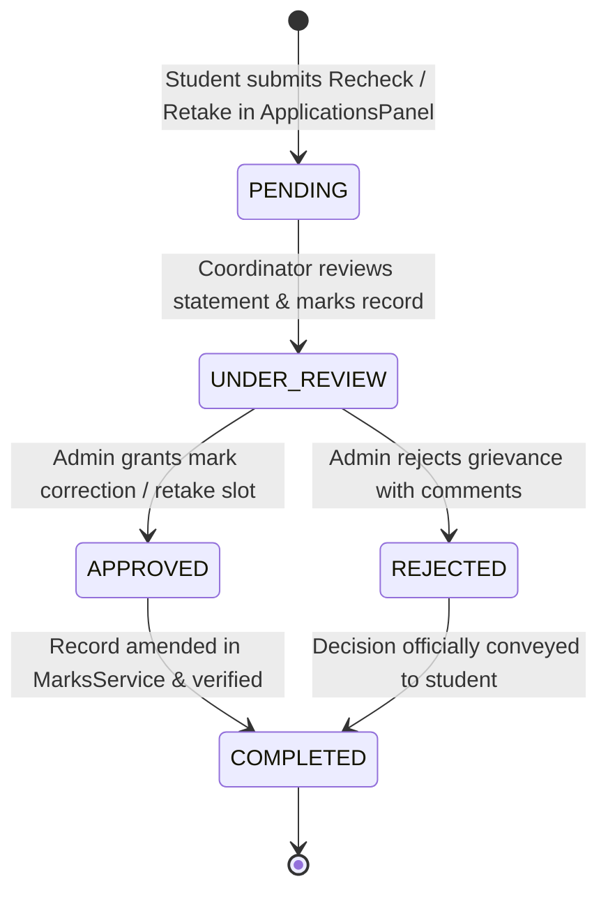

# Inter-Module Integration & Data Flow Specification — EduAsset

## University Examination & Academic Assessment Management System

---

## 1. Integration Architecture Overview

EduAsset integrates presentation, business logic, and persistent storage using a clean **Model-Service-UI** pattern with **Singleton** services and **Observer** event notification.

```
┌────────────────────────────────────────────────────────┐
│                   UI Presentation Layer                │
│    DashboardPanel  StudentPanel  ExamPanel  MarksPanel  │
└───────────────────────────┬────────────────────────────┘
                            │ Synchronous Calls on EDT
                            ▼
┌────────────────────────────────────────────────────────┐
│                 Service Integration Layer              │
│    AuthService ──► StudentService ──► CourseService    │
│         │               │                   │          │
│         ▼               ▼                   ▼          │
│    ExamService ──► MarksService ───► ResultService     │
│         │                                   │          │
│         ▼                                   ▼          │
│    SeatService                         ReportService   │
└───────────────────────────┬────────────────────────────┘
                            │ Read / Write Serialized Objects
                            ▼
┌────────────────────────────────────────────────────────┐
│                   File Storage Layer                   │
│                   FileStorageService                   │
│          ./data/*.dat Binary Object Files              │
└────────────────────────────────────────────────────────┘
```

---

## 2. Core Module Integration Workflows

### 2.1 Examination Scheduling & Conflict Engine Integration

When an administrator schedules a new examination session in `ExamPanel`, the request passes through the `ExamService` conflict engine:



---

### 2.2 Continuous Assessment to Official Result Pipeline

The workflow from mark recording to official publication spans three coordinated services:



---

### 2.3 Student Grievance & Application Lifecycle



1. **Submission:** `ApplicationPanel` calls `ApplicationService.submitApplication(ApplicationRequest)`. Status initialized to `PENDING`.
2. **Review:** Administrative reviewer updates status to `UNDER_REVIEW` and records initial evaluation notes.
3. **Decision:** Reviewer invokes `updateApplicationStatus(appId, "APPROVED", comments)`.
4. **Resolution:** If approved, course instructor updates marks in `MarksService`, which triggers automated GPA recalculation in `ResultService`.

---

## 3. UI-to-Service Integration Patterns

All Swing user interface panels integrate with the business layer using standard patterns:

1. **Singleton Access:** UI components obtain service references via static factory methods:
   ```java
   private final ExamService examService = ExamService.getInstance();
   private final CourseService courseService = CourseService.getInstance();
   ```
2. **Observer Pattern for Theming:** Every panel registers a callback with `ThemeManager`:
   ```java
   theme.addThemeChangeListener(this::refreshTheme);
   ```
   When the user toggles Light/Dark mode in `TopBarPanel` or `SettingsPanel`, `ThemeManager` notifies all active panels to repaint with the new palette.

---

## 4. Multi-Threading & Concurrency Rules

1. **Event Dispatch Thread (EDT) Integrity:** All Swing component construction, button event handlers, and table updates run on the EDT (`javax.swing.SwingUtilities.invokeLater`).
2. **Background File I/O (`SwingWorker`):** Lengthy file generation and statistical aggregations run on background worker threads:
   ```java
   SwingWorker<Void, Void> worker = new SwingWorker<>() {
       @Override
       protected Void doInBackground() throws Exception {
           String text = reportService.generateSummaryReport();
           try (FileWriter writer = new FileWriter(targetFile)) {
               writer.write(text);
           }
           return null;
       }
       @Override
       protected void done() {
           JOptionPane.showMessageDialog(mainFrame, "Export complete!");
       }
   };
   worker.execute();
   ```
3. **Synchronized Critical Sections:** Service mutation methods (`enterMarks`, `createExam`, `publishResults`) are marked `synchronized` to ensure thread safety across concurrent operations.

