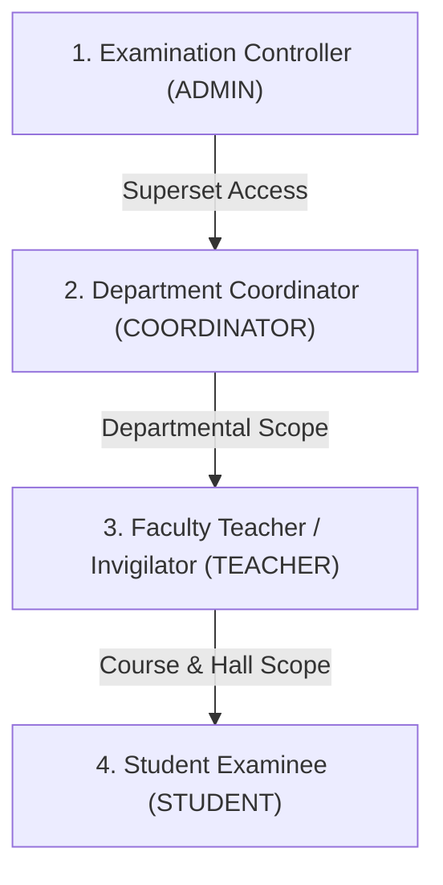

# Security Architecture & Access Control Specification — EduAsset

## University Examination & Academic Assessment Management System

---

## 1. Authentication Architecture

EduAsset implements a credential-based authentication mechanism governed by `AuthService` and `PasswordUtil`:

```
User Input (Plain Password) 
          │
          ▼
   PasswordUtil.hashPassword()
          │
          ├─► Prepend System Salt: "EduAsset@DIU-CSE221-Spring2026#SecureSalt"
          ├─► MessageDigest.getInstance("SHA-256")
          ├─► Hex-encode 256-bit Digest
          ▼
   Compare against Stored PasswordHash
          │
          ├── Match ──► Load Session into AuthService.currentUser
          └── Mismatch ──► throw new InvalidLoginException(...)
```

### Password Protection Guidelines
- **No Plaintext Passwords:** User entities store only the 64-character hexadecimal SHA-256 hash.
- **Salt Defense:** An application-specific salt is prepended to input passwords prior to hashing, defending against pre-computed rainbow table attacks.
- **Deactivated Accounts:** Deactivated accounts (`active == false`) are barred from authenticating even if credentials match.

---

## 2. Authorization & Role-Based Access Control (RBAC)

EduAsset enforces four hierarchical user roles:



### 2.1 RBAC Permission Matrix

| System Action / Resource | Identifier | ADMIN | COORDINATOR | TEACHER | STUDENT |
|---|---|:---:|:---:|:---:|:---:|
| **User Management & Provisioning** | `MANAGE_USERS` | ✅ Allowed | ❌ Denied | ❌ Denied | ❌ Denied |
| **System Settings & Data Backup** | `SYSTEM_SETTINGS` | ✅ Allowed | ✅ Allowed | ✅ Allowed | ✅ Allowed |
| **Student Directory Modification** | `MANAGE_STUDENTS` | ✅ Allowed | ✅ Allowed | ❌ Denied | ❌ Denied |
| **Course & Curriculum Editing** | `MANAGE_COURSES` | ✅ Allowed | ✅ Allowed | ❌ Denied | ❌ Denied |
| **Schedule Examination Session** | `SCHEDULE_EXAM` | ✅ Allowed | ✅ Allowed | ❌ Denied | ❌ Denied |
| **Cancel Examination Session** | `CANCEL_EXAM` | ✅ Allowed | ✅ Allowed | ❌ Denied | ❌ Denied |
| **Hall Room & Seating Allocation**| `MANAGE_SEATING` | ✅ Allowed | ✅ Allowed | ❌ Denied | ❌ Denied |
| **Invigilator Roll-Call Marking** | `MARK_ATTENDANCE` | ✅ Allowed | ✅ Allowed | ✅ Allowed | ❌ Denied |
| **Assessment Marks Entry** | `ENTER_MARKS` | ✅ Allowed | ✅ Allowed | ✅ Allowed | ❌ Denied |
| **Compute Semester GPA Batch** | `CALCULATE_GPA` | ✅ Allowed | ✅ Allowed | ❌ Denied | ❌ Denied |
| **Publish Official Results** | `PUBLISH_RESULTS` | ✅ **Sole Authority** | ❌ Denied | ❌ Denied | ❌ Denied |
| **Review & Approve Grievances** | `APPROVE_GRIEVANCE`| ✅ Allowed | ✅ Allowed | ❌ Denied | ❌ Denied |
| **Submit Academic Grievance** | `SUBMIT_APPLICATION`| ❌ Denied | ❌ Denied | ❌ Denied | ✅ Allowed |
| **Inspect Institutional Analytics** | `VIEW_REPORTS` | ✅ Allowed | ✅ Allowed | ❌ Denied | ❌ Denied |

---

## 3. Defense-in-Depth: Service-Layer Enforcement

In accordance with enterprise architectural standards, EduAsset **does not rely solely on hiding UI buttons** for access control. The service layer strictly validates permissions:

```java
public synchronized void publishResults(int semester, String adminUserId) throws AuthorizationException {
    User user = AuthService.getInstance().getUserById(adminUserId);
    if (user == null || !"ADMIN".equalsIgnoreCase(user.getRole())) {
        throw new AuthorizationException("Only the Examination Controller (Admin) can publish results.");
    }
    // Execution continues only if validation passes...
}
```

If an unauthorized role attempts to invoke protected methods programmatically or through manipulated controls, the service throws `AuthorizationException`, blocking execution.

---

## 4. Input Validation & Boundary Enforcement

All data entered into forms is checked by `ValidationUtil.java` and domain services:

1. **User / Course IDs:** Must be non-empty alphanumeric strings matching `^[A-Za-z0-9_-]+$`.
2. **Email Addresses:** Must match standard RFC 5322 regex: `^[A-Za-z0-9+_.-]+@[A-Za-z0-9.-]+$`.
3. **Assessment Marks:** Component scores must be non-negative and cannot exceed their respective maximums:
   - Class Test $\le 20.0$
   - Assignment $\le 10.0$
   - Midterm $\le 30.0$
   - Final Exam $\le 40.0$
4. **Examination Timetable:**
   - Date must conform to ISO format: `YYYY-MM-DD`.
   - Start and End times must conform to 24-hour format: `HH:mm`.
   - Start time must precede end time (`startTime < endTime`).
5. **Room Capacity:** Total assigned examinees cannot exceed physical hall seats ($\text{assigned} \le \text{capacity}$).

---

## 5. Result Confidentiality & Publication Gating

Examination marks and GPAs are sensitive academic records. EduAsset enforces a two-tier confidentiality gate:

```
[Teachers Input Marks]
          │
          ▼
   MarksRecord Saved
          │
          ▼
   ResultService.calculateResults() ──► Result.isPublished() == FALSE (Draft)
          │
          ├── Non-Admin / Student View ──► "UNPUBLISHED (DRAFT)" (Hidden / Redacted)
          │
          ▼
   Examination Controller (ADMIN001) clicks "Publish Batch"
          │
          ▼
   ResultService.publishResults(semester, "ADMIN001")
          │
          ├─► Set Result.published = true
          ├─► Set Result.publishedBy = "ADMIN001"
          ├─► Set Result.publishDate = currentTimestamp
          ▼
   Official Results Visible on Student Transcripts
```

---

## 6. Persistence & File Storage Security

1. **Local Binary Files:** Serialized `.dat` files reside in the `./data/` directory.
2. **Tamper Resilience:** Serialized object graphs are protected against manual text manipulation; corrupted streams throw `IOException` which the system catches and flags.
3. **Automated Backups:** System administrators can trigger snapshots to the `./backup/` directory via `FileStorageService.backupData()`.

---

## 7. Academic Scope Limitations

- This system is designed as an offline academic desktop demonstration for **CSE 221**.
- Network encryption (TLS/SSL) is not applicable because communication occurs locally within the Java Virtual Machine.
- Hardware cryptographic tokens (e.g. smartcards, HSMs) and multi-factor SMS/TOTP authentication are out of scope.

