# UML Class Diagrams & Architectural Object Hierarchy — EduAsset

## University Examination & Academic Assessment Management System

---

## 1. Complete System Class Diagram (Mermaid)

```mermaid
classDiagram
    direction TB

    %% ─── Interfaces ────────────────────────────────────────────────
    class Searchable {
        <<interface>>
        +matchesSearch(String query)* boolean
    }

    class Approvable {
        <<interface>>
        +approve(String comments)* void
        +reject(String comments)* void
        +getApprovalStatus()* String
    }

    class ReportGenerator {
        <<interface>>
        +generateReport()* String
        +exportReport(String filePath)* void
    }

    %% ─── Core User Hierarchy ──────────────────────────────────────
    class User {
        <<abstract>>
        -String userId
        -String fullName
        -String email
        -String passwordHash
        -String role
        -boolean active
        -String createdDate
        +User()
        +User(userId, fullName, email, passwordHash, role)
        +getDashboardDescription()* String
        +getDisplayRole()* String
        +matchesSearch(query) boolean
        +getUserId() String
        +setUserId(userId) void
        +getFullName() String
        +setFullName(fullName) void
        +getEmail() String
        +setEmail(email) void
        +getPasswordHash() String
        +setPasswordHash(hash) void
        +getRole() String
        +isActive() boolean
        +setActive(active) void
    }

    class Student {
        -String department
        -String program
        -int semester
        -String contactNumber
        +Student()
        +Student(studentId, fullName, email, passwordHash, department, program, semester, contact)
        +getDashboardDescription() String
        +getDisplayRole() String
        +matchesSearch(query) boolean
        +getStudentId() String
        +getDepartment() String
        +setDepartment(dept) void
        +getProgram() String
        +getSemester() int
        +setSemester(sem) void
        +getContactNumber() String
    }

    class Teacher {
        -String department
        -String designation
        -List~String~ assignedCourseIds
        +Teacher()
        +Teacher(teacherId, fullName, email, passwordHash, department, designation)
        +getDashboardDescription() String
        +getDisplayRole() String
        +matchesSearch(query) boolean
        +getTeacherId() String
        +getDepartment() String
        +getDesignation() String
        +addAssignedCourse(courseCode) void
        +removeAssignedCourse(courseCode) void
        +getAssignedCourseIds() List~String~
    }

    class Admin {
        -String designation
        +Admin()
        +Admin(adminId, fullName, email, passwordHash, designation)
        +getDashboardDescription() String
        +getDisplayRole() String
        +getDesignation() String
        +setDesignation(designation) void
    }

    class DepartmentCoordinator {
        -String department
        +DepartmentCoordinator()
        +DepartmentCoordinator(coordId, fullName, email, passwordHash, department)
        +getDashboardDescription() String
        +getDisplayRole() String
        +getDepartment() String
        +setDepartment(department) void
    }

    %% ─── Academic Entities ─────────────────────────────────────────
    class Department {
        -String departmentId
        -String departmentName
        -String headOfDepartment
        -List~String~ programs
        -List~String~ courseIds
        +Department()
        +Department(deptId, deptName)
        +addProgram(program) void
        +addCourse(courseCode) void
        +removeCourse(courseCode) void
    }

    class Course {
        -String courseCode
        -String courseName
        -String departmentId
        -int credits
        -int semester
        -String teacherId
        -List~String~ enrolledStudentIds
        +Course()
        +Course(courseCode, courseName, deptId, credits, semester)
        +enrollStudent(studentId) void
        +removeStudent(studentId) void
        +getEnrolledStudentIds() List~String~
    }

    %% ─── Examination & Seating Entities ────────────────────────────
    class Exam {
        -String examId
        -String courseCode
        -String examType
        -int semester
        -String examDate
        -String startTime
        -String endTime
        -String roomId
        -String invigilatorId
        -String status
        +Exam()
        +Exam(examId, courseCode, examType, semester, examDate, startTime, endTime)
    }

    class ExamRoom {
        -String roomId
        -String building
        -int capacity
        -boolean available
        -List~String~ facilities
        +ExamRoom()
        +ExamRoom(roomId, building, capacity)
        +addFacility(facility) void
    }

    class SeatAssignment {
        -String seatId
        -String examId
        -String roomId
        -String studentId
        -int seatNumber
        +SeatAssignment()
        +SeatAssignment(seatId, examId, roomId, studentId, seatNumber)
    }

    class AttendanceRecord {
        -String attendanceId
        -String examId
        -String studentId
        -String status
        -String remarks
        -String timestamp
        +AttendanceRecord()
        +AttendanceRecord(attendanceId, examId, studentId, status)
    }

    %% ─── Assessment & Results ──────────────────────────────────────
    class MarkRecord {
        -String markId
        -String courseCode
        -String studentId
        -double classTest
        -double assignment
        -double midterm
        -double finalExam
        -double totalMarks
        -String grade
        -double maxClassTest
        -double maxAssignment
        -double maxMidterm
        -double maxFinalExam
        +MarkRecord()
        +MarkRecord(markId, courseCode, studentId)
        +calculateTotal() double
        +calculateGrade() String
    }

    class Result {
        -String resultId
        -String studentId
        -int semester
        -double gpa
        -double cgpa
        -boolean published
        -String publishedBy
        -String publishDate
        -Map~String,String~ courseGrades
        -Map~String,Double~ courseGradePoints
        -Map~String,Integer~ courseCredits
        +Result()
        +Result(resultId, studentId, semester)
        +calculateGPA() double
        +addCourseResult(course, grade, points, credits) void
    }

    class ApplicationRequest {
        -String applicationId
        -String studentId
        -String applicationType
        -String courseCode
        -String description
        -String status
        -String adminComments
        -String submissionDate
        -String lastUpdated
        +ApplicationRequest()
        +ApplicationRequest(appId, studentId, type, desc)
        +approve(comments) void
        +reject(comments) void
        +getApprovalStatus() String
    }

    %% ─── Relationships ─────────────────────────────────────────────
    Searchable <|.. User
    Approvable <|.. ApplicationRequest

    User <|-- Student
    User <|-- Teacher
    User <|-- Admin
    User <|-- DepartmentCoordinator

    Department "1" o-- "*" Course : offers
    Course "1" --> "*" Student : enrolls
    Course "*" --> "1" Teacher : taught by

    Exam "*" --> "1" Course : tests
    Exam "*" --> "1" ExamRoom : hosted in
    Exam "*" --> "1" Teacher : supervised by

    Exam "1" *-- "*" SeatAssignment : assigns
    SeatAssignment "*" --> "1" Student : allocated to
    SeatAssignment "*" --> "1" ExamRoom : located in

    Exam "1" *-- "*" AttendanceRecord : logs
    AttendanceRecord "*" --> "1" Student : records

    Course "1" *-- "*" MarkRecord : assesses
    MarkRecord "*" --> "1" Student : awarded to

    Student "1" *-- "*" Result : receives
    Student "1" *-- "*" ApplicationRequest : lodges
```

---

## 2. Multiplicity & Relationship Descriptions

1. **User Specialization (Generalization/Inheritance):**
   - `User` is an `abstract` class implementing `Serializable` and `Searchable`.
   - `Student`, `Teacher`, `Admin`, and `DepartmentCoordinator` exhibit a strict **IS-A** relationship with `User`.
2. **Department to Course (Aggregation `1` to `*`):**
   - A `Department` offers zero or more `Course`s. If a department is archived, historical course records remain in the university catalog.
3. **Course to Student (Association `*` to `*`):**
   - A `Course` enrolls multiple `Student`s; each `Student` registers for multiple `Course`s per semester.
4. **Exam to SeatAssignment (Composition `1` to `*`):**
   - An `Exam` session possesses zero or more `SeatAssignment` entries. If an exam is cancelled, its seating allocation is released.
5. **MarkRecord to Student & Course (Association):**
   - Each `MarkRecord` links exactly one `Student` to one evaluated `Course`.
6. **Result to Student (Composition `*` to `1`):**
   - A `Student` earns one official `Result` record per completed academic semester.
7. **ApplicationRequest (Interface Implementation):**
   - `ApplicationRequest` implements `Approvable`, providing polymorphism for administrative decisions.

